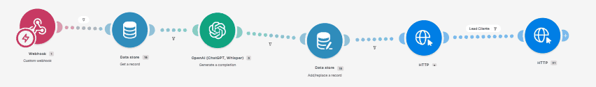
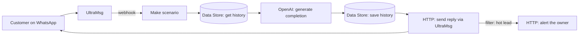

# AI Restaurant Bot

A conversational AI agent that answers customers on WhatsApp, takes table reservations, remembers each conversation and alerts the owner the moment a booking is confirmed. Built with no-code orchestration (Make) plus the OpenAI API; it works 24/7 without a human in the loop.

## What it does

- Answers menu, hours, location, parking, delivery and dietary questions in short, natural WhatsApp-style messages
- Takes reservations step by step: date, time, party size and name, then confirms with a fixed closing sentence
- Keeps per-customer conversation memory, so it never repeats a question already answered
- Scores every conversation as HOT, WARM or COLD and, on a HOT lead, notifies the owner instantly
- Hands off to a human for complaints, large groups, events and anything it cannot answer with certainty
- Reusable: one prompt template, one block of per-restaurant data to fill in, so onboarding a new venue is a matter of minutes

## Example conversation

A real test run (customer phone number removed):

| Who | Message |
|---|---|
| Customer | Buenas, quisiera reservar una mesa |
| Bot | Buenas, ¿qué día y hora te gustaría reservar? Y, ¿cuántas personas vendrán? |
| Customer | Para el domingo a las 20hs, para 2 personas |
| Bot | Perfecto, para el domingo a las 20 hs hay disponibilidad. ¿A nombre de quién sería la reserva? |
| Customer | A nombre de lucas |
| Bot | Reserva confirmada para Lucas, 2 personas el domingo a las 20 hs. Los esperamos! |
| Owner alert | Nueva reserva - El cliente confirmó. Número: (customer number) · Último mensaje: A nombre de lucas · Respuesta del bot: Reserva confirmada para Lucas, 2 personas el domingo a las 20 hs. |

Four customer messages, one confirmed booking, and the owner is notified in the same minute.

## Architecture

Six modules in a single Make scenario:

1. **Custom webhook**: receives every incoming message from UltraMsg (the WhatsApp Business API layer).
2. **Data Store, get a record**: loads the conversation history of that customer.
3. **OpenAI, generate a completion**: sends the system prompt plus the full history plus the new message to the model.
4. **Data Store, add/replace a record**: saves the updated history, which is what gives the bot its memory.
5. **HTTP, send message**: delivers the reply to the customer through the UltraMsg API.
6. **HTTP, owner alert** (behind a filter): fires only when the lead is classified as HOT.

## Lead scoring

The model appends a hidden tag to every reply. Make reads it, removes it before the message is sent, and uses it to route the conversation.

| Tag | Level | Meaning | Action |
|---|---|---|---|
| `LEAD_FRIO` | COLD | Just browsing, no clear intent | Keep answering |
| `LEAD_TIBIO` | WARM | Showed interest but has not confirmed anything | Push gently toward a booking (max. 3 closing attempts) |
| `LEAD_CALIENTE` | HOT | Confirmed a reservation, time or order | Alert the owner |

The tag never reaches the customer. The scenario filter on the last HTTP module ("Lead Clients") is what makes the alert fire only for confirmed bookings.

## Conversational memory

Each customer has a record in a Make Data Store holding the running conversation. On every message the scenario loads it, appends the new turn and saves it again. The prompt tells the model to read the full history before answering, remember names and dietary preferences, and never ask for something already provided.

## Prompt design

The full system prompt is in [prompts/system-prompt.md](prompts/system-prompt.md) (Spanish, as deployed). Main ideas:

- **Intent flows**: 15 explicit flows (greeting, menu, prices, reservation, hours, delivery, dietary needs, location, parking, events, complaints, returning customers, short confirmations, unknown questions, "talk to a person")
- **Style constraints**: 2-3 lines max, WhatsApp tone, no emojis, never two messages in a row, no repeated phrasing
- **Hard rules**: never invent menu, prices or availability; never confirm a booking without name, date, time and party size; always escalate complaints and large events to a human
- **Closing rules**: ends consultation-stage replies with an action question, ends confirmed bookings with a short confirmation, and stops insisting after three attempts
- **Per-client block**: a fill-in section (name, address, hours, menu, delivery, parking, etc.) so the same prompt serves any restaurant

## Stack

- Make (workflow automation)
- OpenAI GPT-4o-mini
- UltraMsg (WhatsApp Business API)
- Make Data Store (conversational memory)

## Results

- Handles 40+ daily inquiries without human intervention
- Average response time under 3 seconds, 24/7
- Full reservation flow completed in under 5 messages
- Saves 60-90 minutes/day of manual work per business
- Zero missed after-hours reservation requests

## Next steps

- Check real availability against a calendar or reservation system instead of relying on the data supplied in the prompt
- Log confirmed bookings to a Google Sheet or CRM
- Add Instagram DMs as a second channel on the same scenario

## Live demo

Available on request.

> Credentials, webhook URLs, account identifiers and customer data are intentionally not included in this repository.
